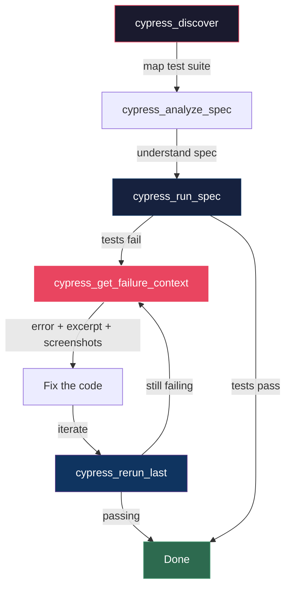

# cypress-mcp

[](https://www.npmjs.com/package/cypress-mcp)
[](LICENSE)
[](https://github.com/jams4code/cypress-mcp/actions/workflows/ci.yml)
[](https://nodejs.org)

MCP server that gives AI coding agents full control over Cypress test execution.

Run, debug, and iterate on E2E tests directly from Claude Code, Cursor, Windsurf, or any MCP-compatible agent, without switching to a terminal. Works alongside [Cypress Cloud MCP](https://docs.cypress.io/cloud/integrations/cloud-mcp): record local runs to Cloud and hand the run URL straight to its tools.

## Install

| Package Manager | Command |
|----------------|---------|
| **npx** (no install) | `npx cypress-mcp --cwd /path/to/project` |
| **npm** | `npm install -g cypress-mcp` |
| **pnpm** | `pnpm add -g cypress-mcp` |
| **yarn** | `yarn global add cypress-mcp` |
| **bun** | `bun add -g cypress-mcp` |
| **From GitHub** | `npx github:jams4code/cypress-mcp` |

## Quick Start

Register with your MCP client:

**Claude Code:**
```bash
claude mcp add cypress-mcp -- npx cypress-mcp --cwd /path/to/project
```

**Cursor / VS Code:**
```json
{
  "mcpServers": {
    "cypress": {
      "command": "npx",
      "args": ["cypress-mcp", "--cwd", "/path/to/your/project"]
    }
  }
}
```

**Windsurf:**
```json
{
  "mcpServers": {
    "cypress": {
      "command": "npx",
      "args": ["cypress-mcp", "--cwd", "/path/to/your/project"]
    }
  }
}
```

## Why

AI agents can write Cypress tests but can't run them. Every change requires you to switch to terminal, run `npx cypress run`, wait, copy the output back. This kills iteration speed.

**cypress-mcp** closes the loop. The agent runs specs, reads failures, views screenshots, inspects crash context, spots flaky tests, reruns the last command, and discovers the test suite, all within the conversation.

## Tools (12)

### Core Loop

| Tool | What it does |
|------|-------------|
| `cypress_run_spec` | Run a spec file headless, get structured JSON results (optionally recorded to Cypress Cloud) |
| `cypress_run_test` | Run a single test by name (grep filter) |
| `cypress_rerun_last` | Replay the exact last run without rebuilding arguments |
| `cypress_list_specs` | List all spec files with test counts |

### Debug

| Tool | What it does |
|------|-------------|
| `cypress_get_failure_context` | Compact debugging bundle: error, stack, spec excerpt, screenshots, next actions |
| `cypress_get_screenshot` | Find failure screenshots by spec or test name |
| `cypress_get_last_run` | Full results of the most recent run, including per-test attempts and flaky flags |

### Discovery

| Tool | What it does |
|------|-------------|
| `cypress_discover` | Map the entire test suite: specs, test names, counts |
| `cypress_analyze_spec` | Deep-parse a spec: describe blocks, visits, intercepts, fixtures |

### Setup

| Tool | What it does |
|------|-------------|
| `cypress_get_config` | Resolved configuration and Cypress Cloud status (projectId, record key present) |
| `cypress_get_env` | Show cypress.env.json (secrets masked) |
| `cypress_doctor` | Health check: config, binary, specs, support file, Cloud setup, directories |

## How It Works


- **stdio transport**: the agent spawns the server as a child process
- **Serial execution**: one Cypress run at a time, no concurrency
- **Structured output**: JSON results with failure details, diffs, screenshot paths, attempts and flaky flags
- **Config-aware**: auto-detects `cypress.config.*`, follows relative imports, respects custom paths
- **No shell**: Cypress is started with `node` directly and every argument is passed verbatim, so test names and paths with spaces, quotes or `&` are safe on every platform
- **Stays in the project**: spec paths outside the project root are rejected
- **Cross-platform**: Windows, macOS, Linux

## Agent Workflow



## Flaky Tests

With [test retries](https://docs.cypress.io/app/guides/test-retries) enabled, every test result carries `attempts` and `flaky`. A test is flaky when it failed and then passed within the same run, the same rule Cypress Cloud uses. Run summaries count them (`All 12 tests passed in login.cy.ts (1 flaky)`), so the agent sees instability on the first run instead of after it reaches CI.

## Cypress Cloud

cypress-mcp runs tests on your machine. [Cypress Cloud MCP](https://docs.cypress.io/cloud/integrations/cloud-mcp) reads results recorded in Cypress Cloud: run history, flaky test analytics, Test Replay, UI Coverage and Accessibility. They do different jobs and work well together. No tool names overlap, so an agent can load both.

**Record a local run.** Pass `record: true` to `cypress_run_spec` or `cypress_run_test`, with optional `tags`, `group` and `ciBuildId`. The result includes the Cloud run:

```json
"cloud": {
  "runUrl": "https://cloud.cypress.io/projects/abc123/runs/42",
  "projectId": "abc123",
  "runNumber": 42
}
```

When a recorded run fails, `nextActions` points the agent at Cloud MCP's `cypress_get_failed_tests` with that URL, for Test Replay links and history.

**Setup.** Recording needs a `projectId` (read from your Cypress config, `CYPRESS_PROJECT_ID`, or `cypress-mcp.config.json`) and a record key. The key goes in the server environment, never in a tool call, so it never passes through the agent:

```json
{
  "mcpServers": {
    "cypress": {
      "command": "npx",
      "args": ["cypress-mcp", "--cwd", "/path/to/your/project"],
      "env": { "CYPRESS_RECORD_KEY": "your-record-key" }
    },
    "cypress-cloud": {
      "type": "http",
      "url": "https://mcp.cypress.io/mcp"
    }
  }
}
```

`cypress_doctor` reports whether recording is ready. Recording is opt-in per call and counts toward your Cypress Cloud test results.

## Configuration

Works out of the box for standard Cypress projects. For custom setups, create `cypress-mcp.config.json`:

```json
{
  "defaultBrowser": "chrome",
  "defaultTimeout": 600000,
  "cypressConfigFile": "config/cypress.config.ts",
  "specPattern": ["e2e/**/*.cy.ts"],
  "supportFile": "support/e2e.ts",
  "titleFilterSupport": true,
  "screenshotsDir": "cypress/screenshots",
  "projectId": "abc123"
}
```

`cypress_run_test` filters by test title through [`@cypress/grep`](https://github.com/cypress-io/cypress/tree/develop/npm/grep). It is detected automatically when the plugin is registered in your support file or config. The filter is passed with `--expose` on Cypress 15.10+ (where `@cypress/grep` 7 reads it) and with `--env` for older plugin versions.

Env values passed to the run tools reach your tests through `cy.env()` on Cypress 15.10+ and `Cypress.env()` on older versions. They are sent as one JSON argument, so commas, quotes and string types are preserved.

## Supported Versions

- Cypress 12.x to 16.x
- Node.js 22.12+ (Node 18 and 20 are end of life)
- Windows, macOS, Linux

## Registry Status

| Registry | Package | Status |
|----------|---------|--------|
| **npm** | [`cypress-mcp`](https://www.npmjs.com/package/cypress-mcp) | Published |
| **GitHub** | [`jams4code/cypress-mcp`](https://github.com/jams4code/cypress-mcp) | Source |

## Development

```bash
git clone https://github.com/jams4code/cypress-mcp.git
cd cypress-mcp
npm install
npm run build
npm test
```

## License

[Apache License 2.0](LICENSE). Free to use, modify and distribute, including commercially and in CI.

Copyright (c) 2026 [JADEV GROUP SARL](https://jadev-group.com) (BE1027.114.687), Brussels, Belgium. See [NOTICE](NOTICE).
